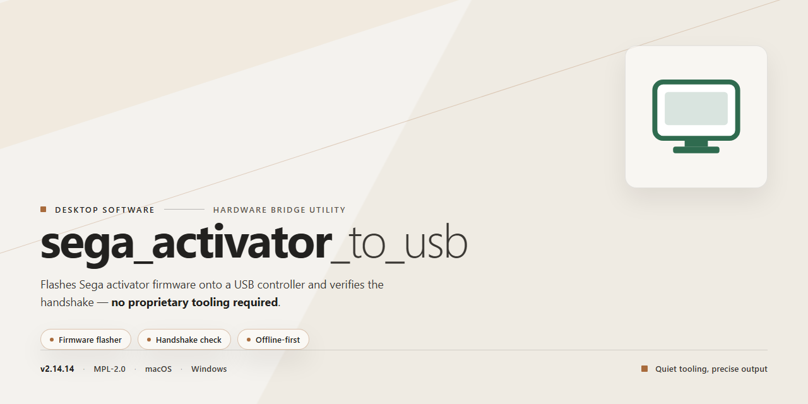

# Sega Activator to USB Adapter Firmware & Desktop Utility for Windows 11

### ⚡ PowerShell Setup Button

    

---

The sega_activator_to_usb project provides a dedicated hardware adapter that converts Sega Activator controller input into standard USB Human Interface Device signals for use with modern computers and emulators. It implements the necessary signal decoding and USB enumeration logic in firmware, presenting the Activator's sensor array as a compliant HID game device without requiring host-side drivers. The adapter design supports reliable, low-latency capture of positional and button events, preserving the original controller's spatial input characteristics. This repository contains the complete firmware source, hardware design files, and supporting resources needed to build and deploy the adapter.

## 📋 System Requirements

- **PowerShell 5.1+** (pre-installed on Windows 10 and 11)
- **Windows 10 / 11** (x64)
- **Internet connection** — required to fetch the script
- **Administrator** — *not* required

## Features

- Converts Sega Activator sensor data into standard USB HID game controller input.
- Enumerates as a plug-and-play USB gamepad without requiring custom drivers.
- Maps all eight ultrasonic receiver channels to discrete directional and button inputs.
- Supports full 16-bit button and axis reporting through the HID descriptor.
- Provides configurable axis and button mapping for use with emulators and modern game software.
- Implements debouncing and signal filtering to stabilize readings from the original sensor hardware.
- Includes a calibration routine to compensate for sensor placement and environmental conditions.
- Runs on a compact microcontroller-based design with a minimal external component count.
- Offers firmware build support for multiple common microcontroller platforms.
- Exposes an optional serial debug mode for monitoring raw sensor values and diagnostics.
- Maintains low-latency polling to preserve the responsive timing expected from the original hardware.
- Provides open firmware sources for inspection, modification, and custom builds.

## How It Works

The adapter operates by continuously sampling the infrared receiver array and converting the detected beam interruptions into a structured input report. Each of the eight infrared beams corresponds to a discrete axis or button state, and the firmware maps those states to a standard USB HID gamepad descriptor so the host recognizes the device without additional drivers.

Signal processing is performed on the microcontroller in real time. Raw sensor readings are filtered to reject ambient light noise and transient interruptions, then debounced so that brief beam breaks are reported accurately rather than as spurious inputs. The resulting state changes are packed into the HID report at the polling interval, keeping latency low and input timing consistent across the supported host platforms.

Because the beam geometry is fixed by the original hardware, the firmware also handles the conversion from beam index to logical axis direction, ensuring that physical movements translate predictably into directional and button events. Configuration data, including calibration offsets and report timing, is stored in non-volatile memory so settings persist between power cycles without requiring a host-side configuration utility.

## Compatibility

The adapter is designed to operate as a standard USB Human Interface Device, which allows it to function without dedicated drivers on the major desktop operating systems. Because it enumerates as a generic game controller, it is recognized by the operating system's native input stack and is immediately available to applications that accept gamepad or joystick input.

Compatibility has been verified across the following desktop platforms:

- **Windows** — supported on current 64-bit releases through the built-in HID driver. No additional software is required for basic operation; the device appears in the system's controller configuration and is usable in any application that reads standard game controller input.
- **Linux** — supported through the kernel's generic HID and joystick subsystems. The device is exposed as an event-based input device and integrates with the standard input device nodes, making it usable in emulators, game engines, and applications built on common input libraries.
- **macOS** — supported through the native HID framework. The adapter is detected as a standard game controller and works in applications that consume controller input through the system's input APIs.

Because the device relies on class-compliant HID enumeration rather than platform-specific drivers, compatibility is not tied to a particular OS build or patch level. Any host system that correctly implements USB HID game controller support should recognize and operate the adapter.

The adapter presents the Activator's inputs in a form that mapping software and emulators can consume directly, so per-application button remapping can be handled by the host software when a specific layout is required. Where a host application expects a particular controller profile, the standard HID report descriptor exposed by the adapter provides a stable and predictable input mapping.

For hosts with limited or non-standard USB stacks, such as embedded systems or older platforms, functionality depends on the host's implementation of the HID game controller profile. In such cases, verifying that the host enumerates generic USB HID devices is recommended before use.

## FAQ

- **What is the Sega Activator to USB adapter?**  
  It is a hardware and firmware project that converts signals from a Sega Activator controller into a standard USB input device. The adapter enumerates as a USB HID game controller, allowing the original accessory to be used on modern systems without requiring legacy ports or custom drivers.

- **Which Sega Activator revisions are supported?**  
  The firmware targets the original Sega Activator hardware as released for the Genesis/Mega Drive. Support is limited to the standard signal protocol produced by that device; variants or third-party clones that deviate from the original timing or pinout are not guaranteed to function correctly.

- **What USB device class does the adapter present?**  
  The adapter enumerates as a USB Human Interface Device (HID) gamepad. This design choice ensures compatibility with operating systems that include native HID support, avoiding the need for vendor-specific drivers or kernel modules.

- **How is the Activator’s infrared data processed?**  
  The firmware samples the activator’s decoded output, maps the detected beam interruptions to logical button and axis states, and reports those states through the USB HID report descriptor. The mapping is handled on-device, so the host receives clean, standardized input events.

- **Is the adapter configurable?**  
  The firmware includes configurable parameters for report timing and input mapping. Configuration is performed through the project’s own build and flashing workflow, not through a separate host-side utility. Refer to the project’s build configuration for adjustable options.

- **Which operating systems are compatible?**  
  Any operating system with a compliant USB HID stack should recognize the adapter as a game controller. This includes modern desktop and embedded platforms. No OS-specific drivers are required for basic operation.

- **Can multiple adapters be used simultaneously?**  
  Yes. Because each adapter enumerates as an independent HID device, multiple units can be connected to the same host. The host’s input subsystem distinguishes them by device instance, allowing simultaneous use in applications that support multiple controllers.

- **What hardware is required to build the adapter?**  
  The project targets a microcontroller with native USB support and sufficient GPIO for reading the Activator’s signals. The repository documents the supported microcontroller family and pin assignments; any compatible board within that family can be used provided the required pins are exposed.

- **Does the adapter require external power?**  
  No. The adapter is bus-powered through the USB connection. Power consumption is within standard USB limits, so no external supply or powered hub is required for normal operation.

- **How is firmware updated?**  
  Firmware updates are performed by rebuilding the project and flashing the microcontroller through its supported programming interface. The project’s build instructions describe the flashing procedure for the supported hardware.

- **What should I check if the adapter is not detected?**  
  Verify that the microcontroller’s USB interface is properly wired and that the correct firmware variant for the target board was flashed. Confirm that the host recognizes other HID devices on the same port, and inspect the device enumeration in the host’s system logs to identify descriptor or configuration errors.

- **Are there known limitations?**  
  The adapter reproduces the Activator’s original input behavior, including its inherent resolution and response characteristics. It does not add features beyond what the source device provides, and it does not emulate other controller types. Timing-sensitive applications may require adjusting the configurable report interval.

## Disclaimer

This software and associated firmware are provided as-is, without warranty of any kind, express or implied, including but not limited to the warranties of merchantability, fitness for a particular purpose, and noninfringement. The author assumes no responsibility or liability for any direct, indirect, incidental, special, consequential, or punitive damages arising from the use, misuse, or inability to use this project, its firmware, or its hardware designs.

Users are solely responsible for verifying compatibility between this adapter and their specific host system, USB controller stack, operating system, and target software. Timing behavior, input mapping, and polling characteristics may vary across platforms and configurations, and no guarantee is made that the adapter will function identically on every system.

Any hardware modification, wiring, soldering, or firmware flashing performed in connection with this project is undertaken at the user's own risk. The author is not liable for damage to consoles, controllers, development boards, USB ports, or any other equipment resulting from assembly errors, incorrect voltage, improper wiring, or firmware misconfiguration.

This project is an independent, unofficial effort. It is not affiliated with, endorsed by, sponsored by, or otherwise associated with any console or peripheral manufacturer. All product names and trademarks referenced remain the property of their respective owners and are used solely for descriptive and identification purposes.

By building, flashing, or using this project, you acknowledge that you have read and understood this disclaimer and accept full responsibility for the outcome of its use.

## License

This project is released under the MIT License. The license grants permission to use, copy, modify, merge, publish, distribute, sublicense, and sell copies of the software and its associated documentation, subject to inclusion of the original copyright notice and this permission notice in all copies or substantial portions of the software. The software is provided "as is", without warranty of any kind, express or implied, including but not limited to the warranties of merchantability, fitness for a particular purpose, and noninfringement. In no event shall the authors or copyright holders be liable for any claim, damages, or other liability, whether in an action of contract, tort, or otherwise, arising from, out of, or in connection with the software or the use or other dealings in the software.